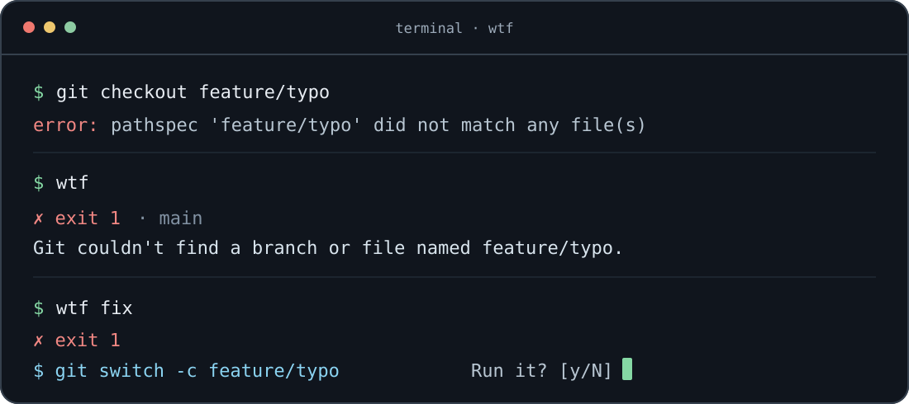

# wtf

**Your last shell command, explained.** Run a command, then ask `wtf` what happened, `wtf explain` why, or `wtf fix` for a corrected command. Answers are short enough to read at the prompt.



> Illustration: example output; your answer depends on the command, captured trace, and selected model.

## Quick start

Requires **Go 1.27.2+**, an interactive **zsh or bash** shell, and at least one provider: [Claude CLI](#providers), [Codex CLI](#providers), [OpenCode](#providers), or [Ollama](#providers).

```sh
git clone https://github.com/d7omdev/wtf.git
cd wtf
make install                 # builds and installs ~/.local/bin/wtf
```

Make sure `~/.local/bin` is on your `PATH`. Add **one** line to your shell's startup file, then open a new terminal:

```sh
# ~/.zshrc (zsh)
eval "$(wtf init zsh)"

# ~/.bashrc (bash) — use this instead if you run bash
eval "$(wtf init bash)"
```

```sh
wtf doctor                  # check the provider and whether a command was captured
wtf use                     # optionally pick and save a provider + model
```

Now run any shell command, wait for the next prompt, and type `wtf`. The hooks record commands automatically; `wtf` does **not** execute the last command again.

## At the prompt

| Command | Result |
| --- | --- |
| `wtf` | Success or failure and what happened, in 1–2 sentences. |
| `wtf explain` | A little more context, up to 3 sentences. |
| `wtf fix` | Prints one suggested command, then asks `Run it? [y/N]` before executing it. |
| `wtf use` | Interactive provider and model picker; persists your choice. |
| `wtf use ollama qwen2.5-coder:7b` | Set a provider and model without the picker. |
| `wtf doctor` | Inspect hooks, configuration, and available providers. |
| `wtf shell` | Start a shell with full terminal-output recording. |
| `wtf version` | Print the version. |

**Review fixes before accepting.** `wtf fix` runs the proposed command via `/bin/sh -c` in the recorded working directory. Press Enter (or `n`) to skip it. Model suggestions can be wrong or destructive.

## Getting useful error context

A shell cannot read the previous command's output after it finishes. `wtf` therefore captures context **when the prompt returns**:

- In a normal terminal, the shell hooks save the command, exit code, timing, and working directory. `wtf` can still respond, but may have no error text.
- In **tmux**, hooks also capture recent pane output (up to 400 lines); this can include other visible terminal text.
- In **`wtf shell` with zsh**, a PTY recorder lets `wtf` retrieve the exact output slice for a command. It writes a terminal log under the state directory; avoid recording sensitive sessions. Bash can use tmux for trace capture.

The state directory defaults to `~/.local/state/wtf` (or `$XDG_STATE_HOME/wtf`). The selected provider receives the command and captured context, which may contain secrets; use Ollama if you need a local backend. Do not run `wtf` on sensitive output unless you trust your provider and local state storage.

## Providers

| Name | How `wtf` calls it |
| --- | --- |
| `claude` | `claude -p` (tries restricted mode when supported) |
| `codex` | `codex exec` in read-only mode |
| `opencode` | `opencode acp` over newline-delimited JSON-RPC |
| `ollama` | Local HTTP `/api/chat` (`OLLAMA_HOST`, default `127.0.0.1:11434`) |

With no configured provider, `wtf` picks the first installed CLI in this order: Claude → Codex → OpenCode → Ollama. An installed CLI still needs its own authentication/setup; Ollama needs a running service and a downloaded model. `wtf use` lets you select a default; flags or environment variables override it per invocation:

```sh
wtf use claude sonnet
wtf --provider ollama --model qwen2.5-coder:7b explain
WTF_PROVIDER=codex wtf
```

## Configuration

`wtf use` writes `$XDG_CONFIG_HOME/wtf/config.json` (default `~/.config/wtf/config.json`):

```json
{
  "provider": "claude",
  "models": { "claude": "sonnet" },
  "timeout_sec": 90
}
```

| Variable / flag | Purpose |
| --- | --- |
| `WTF_PROVIDER`, `WTF_MODEL` | Override the configured backend or model for a call. |
| `WTF_CONFIG`, `WTF_STATE_DIR` | Override config file or state directory paths. |
| `OLLAMA_HOST` | Change the Ollama endpoint. |
| `NO_COLOR`, `--no-color` | Disable color; non-TTY output also has no color. |

Prompts and post-processing enforce short answers: status is capped at 2 sentences / 25 words, explain at 3 sentences / 60 words, and fix at one command line.

## Build and check

```sh
make build                  # bin/wtf
make test                   # go test -race ./...
make lint                   # go vet + gofmt check
```

`make fmt` formats Go sources. The binary is built with Go; runtime backends are external CLIs or a local Ollama server.
